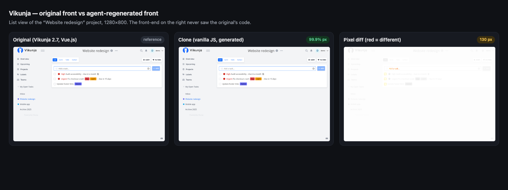
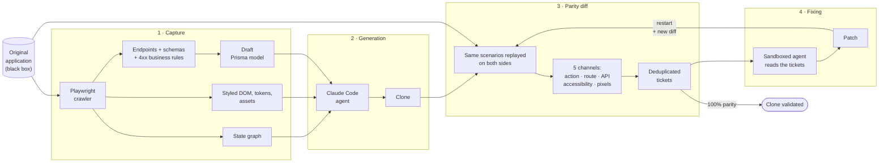
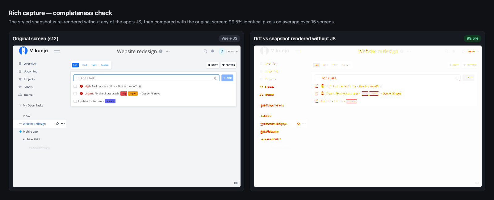
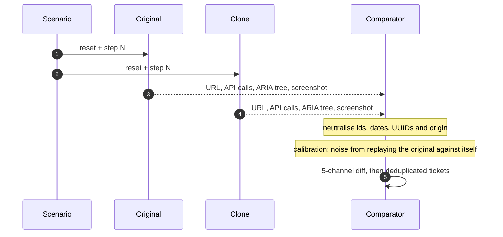
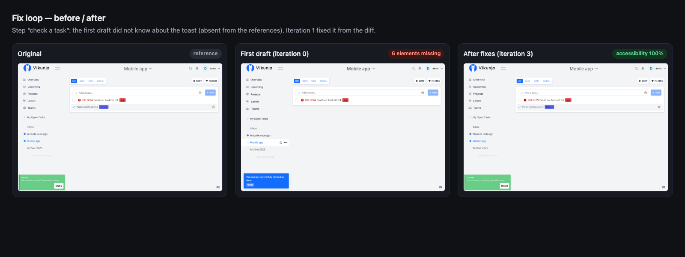
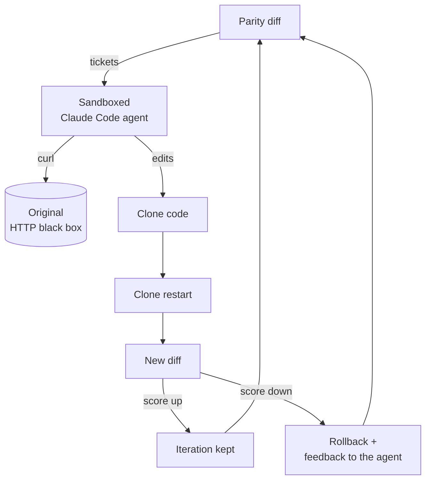
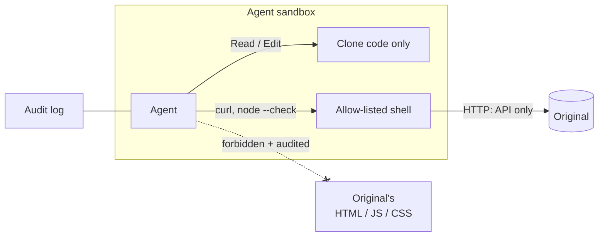

# CloneKit

🇫🇷 [Version française](README.md) · 🇬🇧 English

**Clone web software until an AI cannot tell it apart from the original, and prove it with measurements.**

CloneKit covers the whole process of cloning a web application into an RL training environment:

1. **capture** the original as a black box;
2. **generate** the clone;
3. **measure** parity;
4. let an **agent fix** the gaps until the clone converges.

Every stage outputs numbers you can verify, rather than a vague sense of resemblance.

> Personal project, built for a SaaS cloning engagement aimed at training environments. Validated on a demo and on a real open-source application ([Vikunja](https://vikunja.io), Go + Vue.js).



---

## Key numbers

| Result | Value |
|---|---|
| Vikunja front-end **regenerated by an agent** without access to the original's code | **99.9%** identical pixels, **100%** identical accessibility tree, in 14 min |
| Capture snapshots re-rendered **without the app's JS** | **99.5%** identical pixels (15 screens) |
| Diff false positives (Vikunja 2.7 vs 2.7) | **0** out of 90 checks |
| Real regressions detected (Vikunja 2.7 vs 2.6, not hand-picked) | **31 gaps**, main cause confirmed by the changelog |
| Fix loop on the demo | **50% → 100%** parity in 2 iterations, 2.5 min |
| Injected gaps found on the demo | **5 / 5** |

---

## The pipeline



---

## 1 · Capture: understanding the original from the outside

A crawler explores the application the way a user would. It replays every path from a **reset state**, so explorations never contaminate one another. It produces:

- the UI **state graph** (Mermaid);
- the **API catalogue**: the list of routes, consumed directly by my bot. This is the deliverable I needed. For each route it records:
  - the method and the templated route (`/projects/:id/views/:id/tasks`);
  - the observed status codes;
  - **what the route expects**: body fields, types, formats, enums;
  - **what it returns**: the tree of response fields;
  - the errors observed.

  It comes in two formats: `endpoints.json` for machines and `API.md` for humans (see [the Vikunja example](examples/vikunja-api/API.md): 21 routes);
- the **observed business rules**: each 4xx response is a rule inferred from the outside, e.g. `POST /tasks` with an empty title → 400 "Title is required";
- a **draft Prisma model**, with relations inferred from `xxxId` keys;
- a **rich front-end capture**:
  - the live DOM;
  - a self-contained snapshot with computed styles inlined and each element's box;
  - design tokens;
  - assets (fonts, images, CSS, JS).

Automatic exploration mostly covers navigation. **Writes** (creating, editing, completing or deleting a task) are covered by also replaying the business scenarios (`--scenarios`). On Vikunja this takes the catalogue from 13 to 21 routes, including deletion.

Some request bodies are invisible to Playwright, such as PATCH requests sent as `application/json-patch+json`. They are read back through the Chrome DevTools Protocol and converted into readable fields.

**The capture is verified.** Each snapshot is re-rendered without any of the app's JS, then compared pixel by pixel with the original screen.



This check raised fidelity from 94% to 99.5% by surfacing four causes:
- fonts blocked by CORS;
- modal `::backdrop`s, which do not exist in the DOM;
- empty elements losing their size;
- link colour, which comes from the browser rather than from an inherited style.

## 2 · Parity diff: "indistinguishable for an AI", measured

The same scenarios are replayed **in parallel** on the original and on the clone. Each step is compared on the channels that matter to an agent:

| Channel | What is compared | Why |
|---|---|---|
| **Action** | the step runs on both sides | an agent must never get stuck |
| **Route** | URL, with ids neutralised | identical navigation |
| **API** | calls, status codes, JSON bodies | server behaviour |
| **Accessibility** | ARIA tree | what an agent **reads** |
| **Visual** | pixel diff | what an agent **sees** |



The diff relies on the accessibility tree rather than the DOM. Two front-ends that look identical to an agent can have very different DOMs: generated class names, wrappers, a different framework. Three mechanisms make the result reliable:

- **Neutralisation**: sequential ids vs UUIDs, dates and the origin are not counted as gaps.
- **Calibration**: the original is replayed against itself. Whatever varies (non-deterministic ordering, tokens) is learned as noise and ignored. Result: **0 false positives** on Vikunja 2.7 vs 2.7.
- **Deduplication**: the same defect seen 72 times becomes **a single ticket**, and an API version change (`/v1` → `/v2`) is recognised as one root cause.

On Vikunja 2.7 vs 2.6, two real releases that were not hand-picked, the diff surfaces:
- the front-end switching to API v2;
- wrapped responses instead of arrays;
- `PATCH` instead of `POST`;
- a missing setting.

The official changelog confirms the v2 switch and the missing setting.


Outputs: `report.html` for humans, `TICKETS.md` and `findings.json` for the agent (repro steps and acceptance criteria). Reports are in French.

## 3 · Front-end generation

An agent receives two reference screens from the capture: screenshot, accessibility tree, styled snapshot, tokens, API catalogue, fonts and logo. **It never sees the original front-end's code.**
- It writes a vanilla JS front-end wired to the real API.
- It queries the API to understand the data. Nothing is hard-coded.

| | Parity | Identical pixels | Identical accessibility |
|---|---|---|---|
| First draft (8 min) | 66.7% | 98.2% | 97.7% |
| After 3 fix iterations (+6 min) | **75%** | **99.9%** | **100%** |

The loop also reproduces what the references did not show. The "Success" toast that follows checking a task was absent from them: the diff flagged it and the agent fixed it.



## 4 · Autonomous fix loop



Verification is done **by the tool, never by the agent**.

On the demo, the agent fixes all 5 gaps **at their root cause**: serializer, sorting, validation, CSS, and reproducing a typo of the original ("1 tasks"). To work out the tie-breaking sort rule, it creates probe tasks on the original.


### Clean room by design



- **Code**: the agent only reads the clone's code (file tools are confined). The original is an HTTP black box.
- **Shell**: limited to `curl` and `node --check`. Everything else is refused without prompting.
- **Original front-end assets**: downloading them is forbidden and audited. None happened in the runs above.
- **Traceability**: every tool call is logged.
- **Safeguards**: capped budget per iteration, automatic rollback on regression.

This is **clean-room reimplementation**: understand the behaviour without copying the code.

---

## Running it

```bash
npm install && npx playwright install chromium
```

**Demo (2 min)**: a mini task-management SaaS with an original (:4001) and a clone (:4002) containing 5 deliberate gaps.

```bash
npm run demo          # capture + diff → out/demo-diff/report.html
npm run demo:fix      # fix loop → out/demo-fix/fix-report.html
```

**Running the produced clones**

```bash
# Demo: the clone fixed by the loop (100% parity)
npm run demo:original &           # :4001
npm run demo:clone-fixed          # :4002 → http://localhost:4002

# Vikunja: the regenerated front-end (project list view), wired to a real Vikunja back-end (back-end not cloned)
targets/vikunja/setup.sh 2.7.0 2.7.0   # Docker: original :3456, back-end :3457
npm run vikunja:front                  # → http://localhost:4100/projects/2/9
```

**Vikunja: capture, diff, generation**

```bash
V=targets/vikunja
npm run capture -- http://localhost:3456 --reset-cmd "bash $V/reset.sh {url}" \
  --storage-state $V/data/orig/auth.json --max-depth 1 --out out/vikunja-rich
# full API catalogue (exploration + business scenarios) → out/vikunja-api/API.md
npm run capture -- http://localhost:3456 --reset-cmd "bash $V/reset.sh {url}" \
  --storage-state $V/data/orig/auth.json --max-depth 2 --no-rich --scenarios $V/scenarios --out out/vikunja-api

npm run diff -- --original http://localhost:3456 --clone http://localhost:3457 \
  --scenarios $V/scenarios --reset-cmd "bash $V/reset.sh {url}" \
  --storage-original $V/data/orig/auth.json --storage-clone $V/data/clone/auth.json

npm run gen-front -- --capture out/vikunja-rich --states s12,s14 --harness $V/front \
  --brief $V/front/BRIEF.md --original http://localhost:3456 --clone http://localhost:4100 \
  --scenarios $V/front-scenarios --reset-cmd "bash $V/reset.sh {url}" \
  --storage-original $V/data/orig/auth.json
```

**On a real target**

```bash
npx playwright codegen --save-storage=auth.json https://app.target.com   # log in once
npm run capture -- https://app.target.com --storage-state auth.json --max-depth 3
npm run diff -- --original https://app.target.com --clone http://localhost:3000 \
  --storage-original auth.json --storage-clone auth-clone.json --fail-under 95   # CI-ready
```

Scenarios are JSON, and targets are addressed by role and accessible name, just as an agent would:

```json
{ "name": "Create a task", "steps": [
  { "goto": "/" },
  { "click": { "role": "link", "name": "Website redesign", "exact": false } },
  { "fill": { "role": "textbox", "name": "Task title" }, "value": "Write tests" },
  { "press": "Enter", "on": { "role": "textbox", "name": "Task title" } }
]}
```

---

## In a 10-day cloning sprint

```mermaid
gantt
    dateFormat X
    axisFormat D%s
    section Understand
    Capture + API catalogue + data model        :0, 2
    section Build
    Back-end generated from catalogue and model :2, 5
    Front-end generated from the rich capture   :2, 5
    section Converge
    Diff → fix loop (continuous)                :4, 9
    section Deliver
    Seed, reset, environment packaging          :8, 10
```



- **Before**: parity is judged by eye and fixes are manual.
- **With CloneKit**:
  - parity is a **number tracked every day**;
  - gaps arrive as **tickets with repro steps**;
  - an agent closes the simple tickets while humans focus on the hard business rules.

---

## Stack and choices

| Component | Choice | Why |
|---|---|---|
| Browser automation | **Playwright** | native ARIA snapshots, isolated contexts, network interception, CDP access |
| Language | **TypeScript** (tsx, no build step) | same language as the front-ends being cloned, strict typing |
| Visual diff | **pixelmatch** + pngjs | fast, tunable anti-aliasing threshold |
| Text diff | **diff** (LCS) | accessibility tree alignment, patches |
| Agent | **Claude Code**, headless | confined file tools, fine-grained permissions, auditable stream-json output |
| Test environment | **Docker** + SQLite snapshot | 0.7 s reset, reproducible states |

## Architecture

```
src/
  shared/normalize.ts   id/date/origin neutralisation, URL templating, screen signature
  shared/browser.ts     deterministic context, network recorder, stability wait
  capture/crawler.ts    breadth-first exploration with replay from a reset
  capture/schema.ts     schema inference, entities, draft Prisma model
  capture/rich.ts       self-contained styled DOM, design tokens, assets, fidelity check
  diff/scenario.ts      scenario execution and per-step observation
  diff/compare.ts       5-channel comparison, ARIA matching, similarity scores
  diff/report.ts        report.html, TICKETS.md, findings.json
  diff/run.ts           orchestration and calibration
  gen/front.ts          agent-driven front-end generation from a rich capture
  fix/agent.ts          sandboxed Claude Code agent, call auditing
  fix/loop.ts           diff → fix → diff loop, rollback, report
examples/
  vikunja-api/          API catalogue inferred from Vikunja (API.md, endpoints.json, Prisma, state graph)
  demo-clone-fixed/     demo clone after the loop (+ patch written by the agent)
  vikunja-front/        Vikunja front-end generated by the agent (public/) + harness
demo/                   mini SaaS: original + clone with 5 injected gaps
targets/vikunja/        Docker, deterministic seed, reset, scenarios, front-end harness
```

## Known limitations and next steps

- **Back-end: deliberately not generated.** I needed the **route catalogue** (`endpoints.json`), which my bot uses directly, not a cloned server. The regenerated Vikunja front-end therefore runs on a real Vikunja back-end. The catalogue, schemas, 4xx rules and draft Prisma model are already the inputs needed to generate a back-end if an engagement calls for it.
- **Exploration**: the traversal is systematic. Next step: an agent that picks meaningful inputs (edge cases, roles, permissions) and targets endpoint coverage.
- **Scenarios**: hand-written for now. They can be generated from the state graph.
- **Visual**: the check is binary (more than 20 differing pixels fails the step). On the Vikunja front-end, 130 remaining pixels (0.01%) keep parity at 75% despite 99.9% similarity. The agent needs a zoom tool for diff images.
- **Scope**: websockets, emails and third-party services must be simulated. Desktop applications would be captured through OS accessibility APIs rather than the DOM.
- **Interface language**: the CLI, reports and code comments are in French.
- **Costs**: ~$6 for the loop on the demo, ~$4.30 to generate and fix the Vikunja front-end. These are estimates at API rates, covered by a Claude Code subscription.
