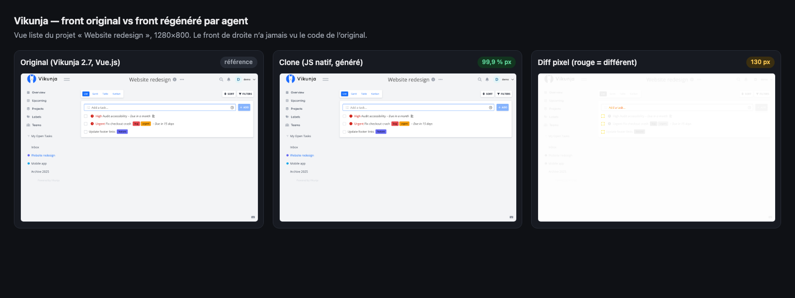
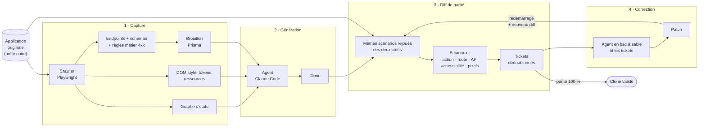
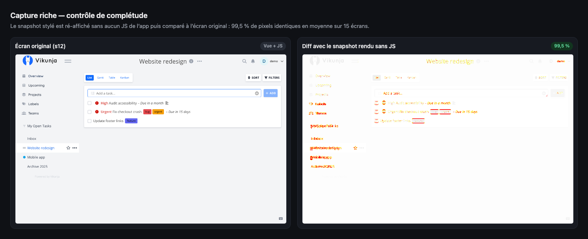
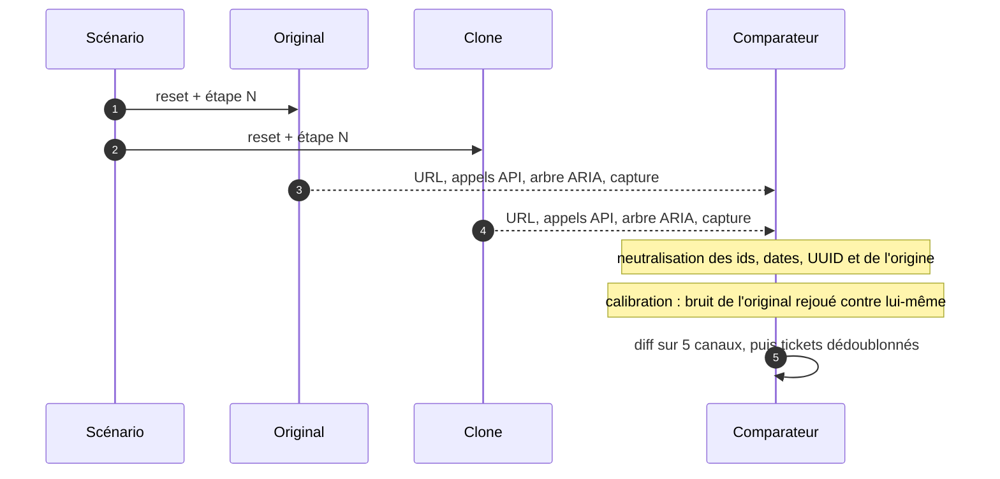
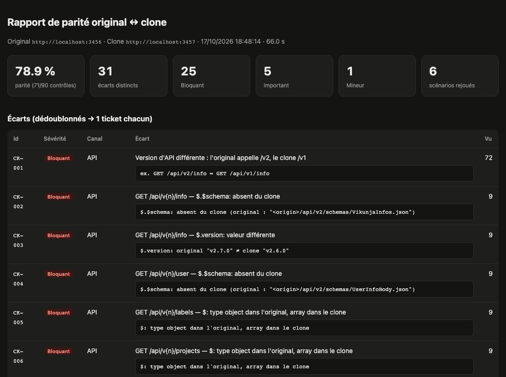
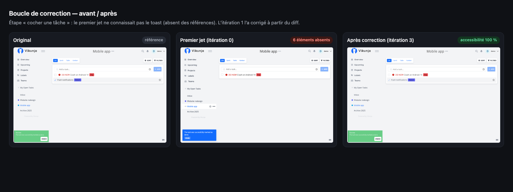
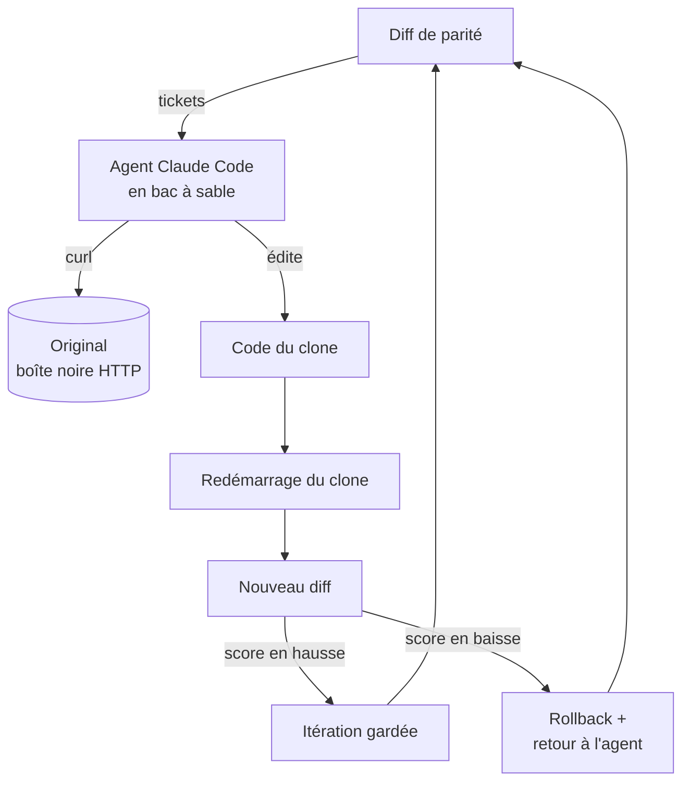
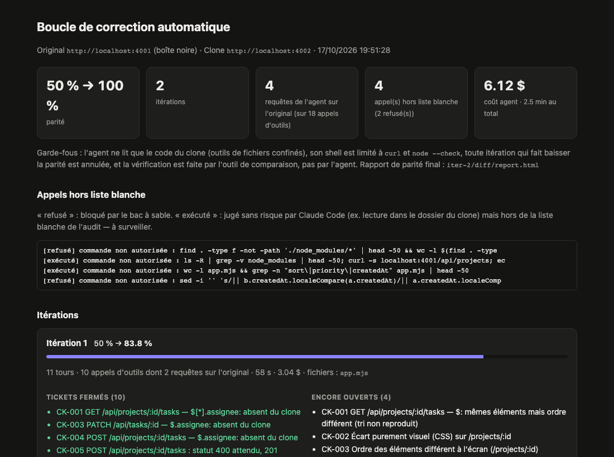
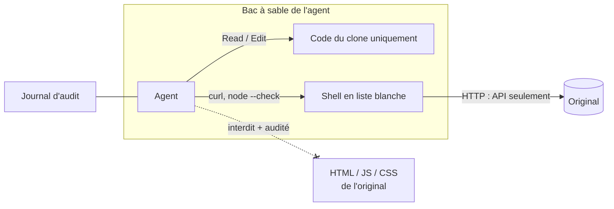

# CloneKit

**Cloner un logiciel web jusqu'à le rendre indiscernable pour une IA, et le prouver par la mesure.**

CloneKit outille la chaîne complète du clonage d'une application web pour en faire un environnement d'entraînement RL :

1. **capturer** l'original en boîte noire ;
2. **générer** le clone ;
3. **mesurer** la parité ;
4. laisser un **agent corriger** les écarts jusqu'à convergence.

Chaque étape produit des chiffres vérifiables, pas une impression de ressemblance.

> Projet personnel, conçu pour une mission de clonage de SaaS destinée à des environnements d'entraînement. Validé sur une démo et sur une vraie application open source ([Vikunja](https://vikunja.io), Go + Vue.js).



---

## En chiffres

| Résultat | Valeur |
|---|---|
| Front Vikunja **régénéré par agent** sans voir le code de l'original | **99,9 %** de pixels identiques, **100 %** de l'arbre d'accessibilité, en 14 min |
| Snapshots de capture ré-affichés **sans le JS de l'app** | **99,5 %** de pixels identiques (15 écrans) |
| Faux positifs du diff (Vikunja 2.7 contre 2.7) | **0** sur 90 contrôles |
| Vraies régressions détectées (Vikunja 2.7 contre 2.6, non choisies) | **31 écarts**, cause principale confirmée par le changelog |
| Boucle de correction sur la démo | **50 % → 100 %** de parité en 2 itérations, 2,5 min |
| Écarts injectés retrouvés sur la démo | **5 / 5** |

---

## Le pipeline



---

## 1 · Capture : comprendre l'original de l'extérieur

Un crawler explore l'application comme un utilisateur. Il rejoue chaque chemin depuis un **état réinitialisé**, pour que deux explorations ne se contaminent jamais. Il produit :

- le **graphe d'états** de l'interface (Mermaid) ;
- le **catalogue d'API** : la liste des routes, que mon bot consomme directement. C'est le livrable dont j'avais besoin. Pour chaque route : méthode, route templatée (`/projects/:id/views/:id/tasks`), statuts, **ce qu'elle demande** (champs du corps, types, formats, enums) et **ce qu'elle renvoie** (arbre des champs de la réponse), erreurs observées. Il est disponible en deux formats : `endpoints.json` pour la machine, `API.md` pour l'humain (voir [l'exemple Vikunja](examples/vikunja-api/API.md) : 21 routes) ;
- les **règles métier observées** : chaque réponse 4xx est une règle déduite de l'extérieur, par exemple `POST /tasks` avec un titre vide → 400 « Title is required » ;
- un **brouillon de modèle Prisma**, avec les relations déduites des clés `xxxId` ;
- une **capture riche du front** : le DOM vivant, un snapshot autonome aux styles calculés inlinés (avec la boîte de chaque élément), les tokens de design et les ressources (polices, images, CSS, JS).

L'exploration automatique couvre surtout la navigation. Les **écritures** (créer, modifier, terminer une tâche) sont couvertes en rejouant aussi les scénarios métier (`--scenarios`) : sur Vikunja, le catalogue passe de 13 à 21 routes, suppression comprise. Les corps que Playwright ne voit pas (PATCH en `application/json-patch+json`) sont relus via le protocole Chrome, puis convertis en champs lisibles.

**La capture est vérifiée.** Chaque snapshot est ré-affiché sans aucun JS de l'app, puis comparé pixel à pixel à l'écran original.



Ce contrôle a fait passer la fidélité de 94 % à 99,5 %, en révélant quatre causes :
- des polices bloquées par CORS ;
- le `::backdrop` des modales, absent du DOM ;
- des éléments vides qui perdaient leur taille ;
- la couleur des liens, qui vient du navigateur et non d'un style hérité.

## 2 · Diff de parité : « indiscernable pour une IA », en mesure

Les mêmes scénarios sont rejoués **en parallèle** sur l'original et sur le clone. Chaque étape est comparée sur les canaux qui comptent pour un agent :

| Canal | Ce qui est comparé | Pourquoi |
|---|---|---|
| **Action** | l'étape s'exécute des deux côtés | un agent ne doit jamais être bloqué |
| **Route** | URL, ids neutralisés | navigation identique |
| **API** | appels, statuts, corps JSON | comportement serveur |
| **Accessibilité** | arbre ARIA | ce qu'un agent **lit** |
| **Visuel** | diff pixel | ce qu'un agent **voit** |



Le diff s'appuie sur l'arbre d'accessibilité plutôt que sur le DOM, parce que deux fronts identiques pour un agent peuvent avoir des DOM très différents : classes générées, wrappers, framework. Trois mécanismes rendent le résultat fiable :

- **Neutralisation** : les ids séquentiels contre les UUID, les dates et l'origine ne sont pas des écarts.
- **Calibration** : l'original est rejoué contre lui-même, et ce qui varie (ordre non déterministe, jetons) est appris comme bruit et ignoré. Résultat : **0 faux positif** sur Vikunja 2.7 contre 2.7.
- **Dédoublonnage** : un même défaut vu 72 fois devient **un seul ticket**. Un changement de version d'API (`/v1` → `/v2`) est reconnu comme une cause unique.

Sur Vikunja 2.7 contre 2.6, deux versions réelles et non choisies, le diff remonte la bascule du front vers l'API v2, des réponses enveloppées au lieu de tableaux, `PATCH` au lieu de `POST` et un réglage absent. Le changelog officiel confirme la bascule v2 et le réglage absent.



Sorties : `report.html` pour l'humain, `TICKETS.md` et `findings.json` pour l'agent (repro et critère d'acceptation).

## 3 · Génération du front

Un agent reçoit deux écrans de référence issus de la capture : capture d'écran, arbre d'accessibilité, snapshot stylé, tokens, catalogue d'API, polices et logo. **Il ne voit jamais le code du front original.**
- Il écrit un front en JS natif, branché sur la vraie API.
- Il interroge l'API pour comprendre les données. Rien n'est codé en dur.

| | Parité | Pixels identiques | Accessibilité identique |
|---|---|---|---|
| Premier jet (8 min) | 66,7 % | 98,2 % | 97,7 % |
| Après 3 itérations de correction (+6 min) | **75 %** | **99,9 %** | **100 %** |

La boucle reproduit aussi ce que les références ne montraient pas. Le toast « Success » qui suit une tâche cochée n'y figurait pas : le diff l'a signalé, l'agent l'a corrigé.



## 4 · Boucle de correction autonome



La vérification est faite **par l'outil, jamais par l'agent**.

Sur la démo, l'agent corrige les 5 écarts **par leur cause** : sérialiseur, tri, validation, CSS, et reproduction d'une faute de l'original (« 1 tasks »). Pour comprendre la règle de tri en cas d'égalité, il crée des tâches de sonde sur l'original.



### Clean room par construction



- **Code** : l'agent ne lit que le code du clone (outils de fichiers confinés). L'original est une boîte noire HTTP.
- **Shell** : limité à `curl` et `node --check`. Le reste est refusé sans question.
- **Ressources du front original** : leur téléchargement est interdit et audité. Aucun n'a eu lieu dans les runs ci-dessus.
- **Traçabilité** : chaque appel d'outil est journalisé.
- **Garde-fous** : budget plafonné par itération, rollback automatique en cas de régression.

C'est le principe de la **réimplémentation en salle blanche** : comprendre le comportement sans copier le code.

---

## Lancer

```bash
npm install && npx playwright install chromium
```

**Démo (2 min)** : un mini SaaS de tâches, avec un original (:4001) et un clone (:4002) qui contient 5 écarts volontaires.

```bash
npm run demo          # capture + diff → out/demo-diff/report.html
npm run demo:fix      # boucle de correction → out/demo-fix/fix-report.html
```

**Lancer les clones produits**

```bash
# Démo : le clone corrigé par la boucle (100 % de parité)
npm run demo:original &           # :4001
npm run demo:clone-fixed          # :4002 → http://localhost:4002

# Vikunja : le front régénéré (vue liste des projets), branché sur un vrai back Vikunja (back non cloné)
targets/vikunja/setup.sh 2.7.0 2.7.0   # Docker : original :3456, back :3457
npm run vikunja:front                  # → http://localhost:4100/projects/2/9
```

**Vikunja : capture, diff, génération**

```bash
V=targets/vikunja
npm run capture -- http://localhost:3456 --reset-cmd "bash $V/reset.sh {url}" \
  --storage-state $V/data/orig/auth.json --max-depth 1 --out out/vikunja-rich
# catalogue d'API complet (exploration + scénarios métier) → out/vikunja-api/API.md
npm run capture -- http://localhost:3456 --reset-cmd "bash $V/reset.sh {url}" \
  --storage-state $V/data/orig/auth.json --max-depth 2 --no-rich --scenarios $V/scenarios --out out/vikunja-api

npm run diff -- --original http://localhost:3456 --clone http://localhost:3457 \
  --scenarios $V/scenarios --reset-cmd "bash $V/reset.sh {url}" \
  --storage-original $V/data/orig/auth.json --storage-clone $V/data/clone/auth.json

npm run gen-front -- --capture out/vikunja-rich --states s12,s14 --harness $V/front \
  --brief $V/front/BRIEF.md --original http://localhost:3456 --clone http://localhost:4100 \
  --scenarios $V/front-scenarios --reset-cmd "bash $V/reset.sh {url}" \
  --storage-original $V/data/orig/auth.json
```

**Sur une vraie cible**

```bash
npx playwright codegen --save-storage=auth.json https://app.cible.com   # connexion une fois
npm run capture -- https://app.cible.com --storage-state auth.json --max-depth 3
npm run diff -- --original https://app.cible.com --clone http://localhost:3000 \
  --storage-original auth.json --storage-clone auth-clone.json --fail-under 95   # utilisable en CI
```

Les scénarios sont du JSON, et les cibles sont désignées par rôle et nom accessible, comme le ferait un agent :

```json
{ "name": "Créer une tâche", "steps": [
  { "goto": "/" },
  { "click": { "role": "link", "name": "Website redesign", "exact": false } },
  { "fill": { "role": "textbox", "name": "Task title" }, "value": "Write tests" },
  { "press": "Enter", "on": { "role": "textbox", "name": "Task title" } }
]}
```

---

## Dans un sprint de clonage de 10 jours

```mermaid
gantt
    dateFormat X
    axisFormat J%s
    section Comprendre
    Capture + catalogue API + modèle de données   :0, 2
    section Construire
    Back généré depuis le catalogue et le modèle  :2, 5
    Front généré depuis la capture riche          :2, 5
    section Converger
    Boucle diff → correction (en continu)         :4, 9
    section Livrer
    Seed, reset, packaging de l'environnement     :8, 10
```



- **Avant** : la parité se juge à l'œil, et la correction est manuelle.
- **Avec CloneKit** :
  - la parité est un **chiffre suivi chaque jour** ;
  - les écarts arrivent sous forme de **tickets avec repro** ;
  - un agent ferme les tickets simples, et les humains se concentrent sur les règles métier difficiles.

---

## Stack et choix

| Brique | Choix | Pourquoi |
|---|---|---|
| Pilotage navigateur | **Playwright** | snapshot ARIA natif, contextes isolés, interception réseau, accès CDP |
| Langage | **TypeScript** (tsx, sans build) | même langage que les fronts à cloner, typage strict |
| Diff visuel | **pixelmatch** + pngjs | rapide, seuil d'anticrénelage réglable |
| Diff texte | **diff** (LCS) | alignement des arbres d'accessibilité, patchs |
| Agent | **Claude Code** en mode headless | outils de fichiers confinés, permissions fines, sortie stream-json auditable |
| Environnement de test | **Docker** + snapshot SQLite | reset en 0,7 s, états reproductibles |

## Architecture

```
src/
  shared/normalize.ts   neutralisation ids/dates/origine, templating d'URL, signature d'écran
  shared/browser.ts     contexte déterministe, enregistreur réseau, attente de stabilité
  capture/crawler.ts    exploration en largeur avec rejeu depuis un reset
  capture/schema.ts     inférence de schéma, entités, brouillon Prisma
  capture/rich.ts       DOM stylé autonome, tokens de design, ressources, contrôle de fidélité
  diff/scenario.ts      exécution d'un scénario et observation par étape
  diff/compare.ts       comparaison sur 5 canaux, appariement ARIA, similarités
  diff/report.ts        report.html, TICKETS.md, findings.json
  diff/run.ts           orchestration et calibration
  gen/front.ts          génération d'un front par agent à partir d'une capture riche
  fix/agent.ts          agent Claude Code en bac à sable, audit des appels
  fix/loop.ts           boucle diff → correction → diff, rollback, rapport
examples/
  vikunja-api/          catalogue d'API déduit de Vikunja (API.md, endpoints.json, Prisma, graphe d'états)
  demo-clone-fixed/     clone de la démo après la boucle (+ correctif écrit par l'agent)
  vikunja-front/        front Vikunja généré par l'agent (public/) + harnais
demo/                   mini SaaS original + clone avec 5 écarts injectés
targets/vikunja/        Docker, seed déterministe, reset, scénarios, harnais du front
```

## Limites connues et suite

- **Back : volontairement non généré.** Mon besoin était le **catalogue des routes** (`endpoints.json`), que mon bot exploite directement, pas un serveur cloné. Le front Vikunja régénéré s'appuie donc sur un vrai back Vikunja. Le catalogue, les schémas, les règles 4xx et le brouillon Prisma sont déjà les entrées nécessaires pour générer le back si une mission le demande.
- **Exploration** : le parcours est systématique. La prochaine étape est un agent qui choisit des entrées pertinentes (cas limites, rôles, permissions) et vise la couverture des endpoints.
- **Scénarios** : ils sont écrits à la main. Ils peuvent être générés depuis le graphe d'états.
- **Visuel** : le contrôle est binaire (au-delà de 20 pixels, l'étape échoue). Sur le front Vikunja, 130 pixels restants (0,01 %) maintiennent la parité à 75 % malgré 99,9 % de similarité. Il faudra donner à l'agent un outil de zoom sur les diffs.
- **Périmètre** : websockets, emails et services tiers sont à simuler. Les applications de bureau se captureraient via l'accessibilité de l'OS plutôt que le DOM.
- **Coûts** : ~6 $ pour la boucle sur la démo, ~4,30 $ pour la génération et la correction du front Vikunja. Ce sont des estimations au tarif API, couvertes par un abonnement Claude Code.
